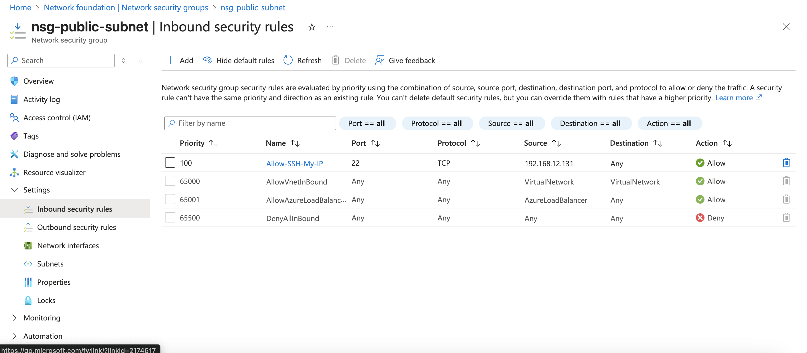
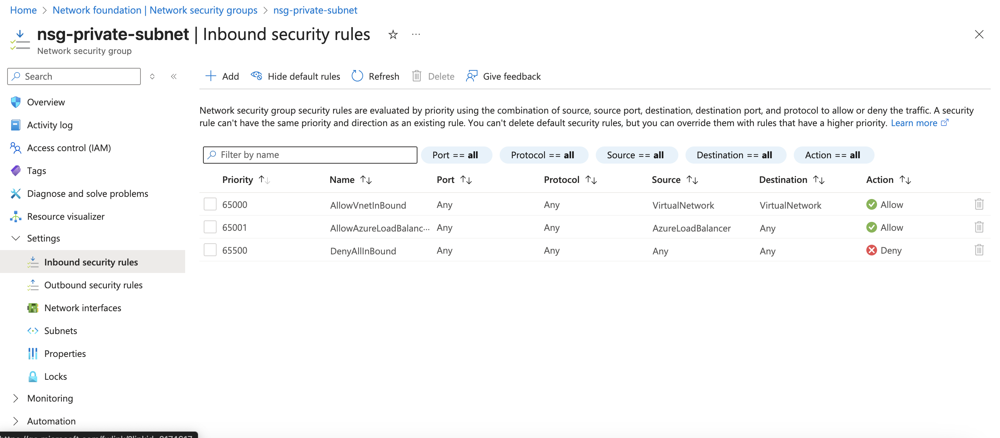
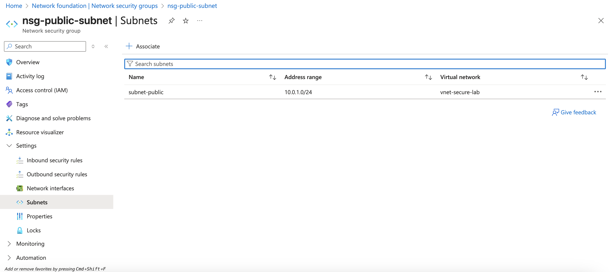
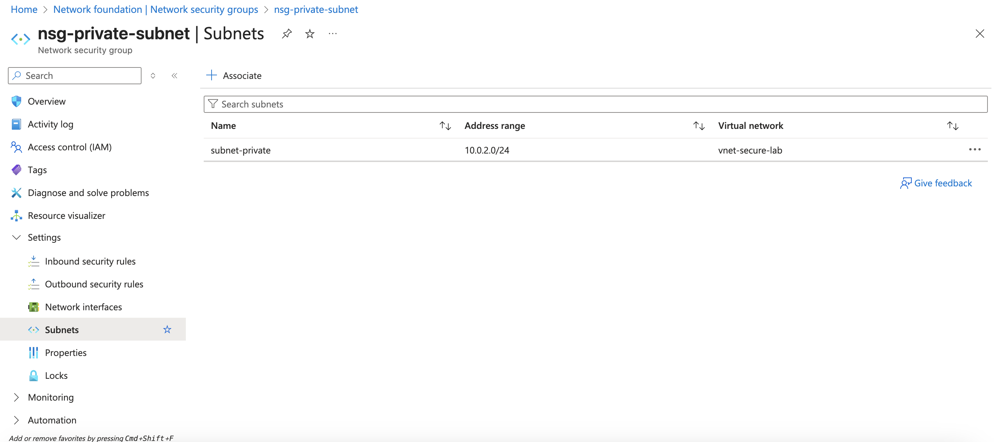

# Azure Secure Network Lab

A hands-on lab demonstrating secure network segmentation in Microsoft Azure using Virtual Networks, subnets, and Network Security Groups (NSGs). This project reflects real-world principles for isolating resources, restricting access, and reducing the attack surface in cloud environments.

---

## Objective

Design and implement a segmented Azure network architecture that limits inbound internet traffic to only what is explicitly required and enforces least privilege between the subnets.

---

## Architecture Overview

| Component | Configuration |
|---|---|
| Azure Virtual Network | 10.0.0.0/16 |
| Public Subnet | 10.0.1.0/24 |
| Private Subnet | 10.0.2.0/24 |
| Security Controls | Subnet-level NSGs |

The public subnet accepts limited inbound traffic (SSH from a single source IP). The private subnet is intended to simulate where internal resources, such as databases or backend services, would live in a production environment.

**Known limitation:** Azure adds default rules to every NSG, including `AllowVnetInBound` (priority 65000), which allows all traffic between resources inside the same virtual network. The private subnet NSG in this lab has no custom rules yet, so the public subnet can still reach it. Blocking that path requires explicit rules with a lower priority number than 65000. See Next Steps.

---

## Security Controls Implemented

- **Public Subnet NSG:** Inbound SSH (port 22) allowed from a single source IP address. Other inbound traffic from the internet is blocked by the default `DenyAllInBound` rule.
- **Private Subnet NSG:** Default rules only. Inbound traffic from the internet is blocked by `DenyAllInBound`. Traffic from inside the virtual network, including the public subnet, is still allowed by the default `AllowVnetInBound` rule.
- **Network Segmentation:** Two subnets with separate NSGs. Segmentation between the subnets is not enforced yet (see Known limitation above).
- **NSG to Subnet Association:** Security rules are applied at the subnet level rather than per VM.

---

## Validation & Testing

This lab was validated by configuration review only. No virtual machines were deployed, so no live traffic was tested.

- Reviewed the inbound rules on the public NSG in the Azure portal
- Reviewed the private subnet NSG and found it contains only Azure default rules
- Confirmed each NSG is associated with the correct subnet
- Reviewed rule priority order, which is how the `AllowVnetInBound` limitation was identified

---

## Tools & Technologies

`Microsoft Azure` `Virtual Networks (VNet)` `Network Security Groups (NSG)` `Subnets` `Azure Portal` `Cloud Network Security` `Least Privilege` `Network Segmentation`

---

## Screenshots

### Public Subnet NSG — Restricted Inbound Rules

### Private Subnet NSG — Default Rules (no custom rules yet)

### Public NSG to Subnet Association

### Private NSG to Subnet Association

---

## 💡 Key Takeaways

- Built a two subnet Azure network and attached an NSG to each subnet
- Learned that NSG default rules matter as much as custom rules: a default deny does not isolate subnets inside the same virtual network
- Practiced reading NSG rules in priority order, including the built in defaults
- Learned the least privilege goal at the network layer, which is a core idea in cloud security and zero trust

---

## Lessons Learned

My first version of this README described the private subnet as isolated. Rechecking the full rule list, including the defaults, showed that Azure's `AllowVnetInBound` rule permits traffic between subnets in the same virtual network. I corrected the README to match what was built. The lesson: read every rule, including the defaults, and test the claim before writing it.

## Next Steps

- [ ] Add a custom rule on the private NSG that allows only the traffic needed from the public subnet, plus a deny rule for the rest (priority lower than 65000)
- [ ] Update the public NSG SSH rule to use my current public IP as the source
- [ ] Deploy one VM in each subnet and test an allowed and a blocked connection
- [ ] Add the test commands and screenshots to this repository
- [ ] Rebuild the network with Terraform

---

## Related Projects

- [Cloud Security Labs](https://github.com/Sebasttianp/cloud-security-labs) — Azure, Entra ID, IAM, and MFA
- [Cloud Security Anomaly Detection](https://github.com/Sebasttianp/cloud-security-anomaly-detection) — ML-based detection for cloud audit logs
